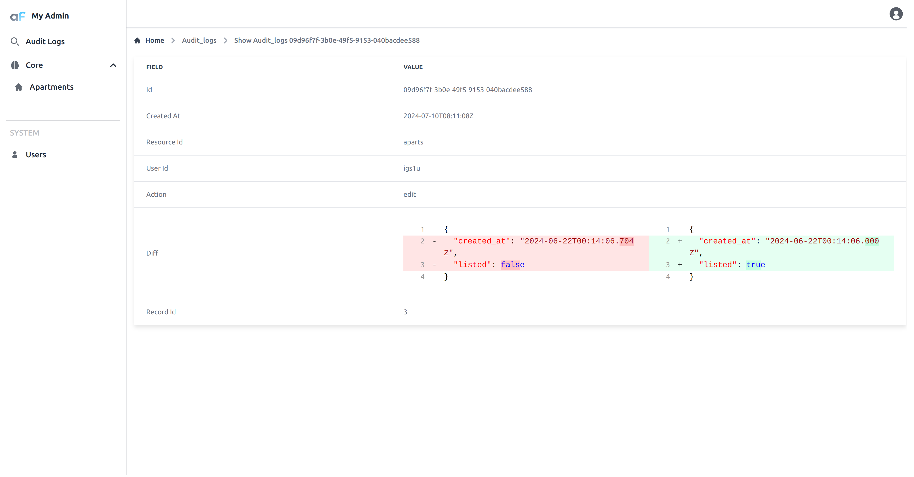

AuditLog plugin allows to log all changes in the resources done from the admin panel. 
It will allow you to figure out who and when made changes in the data. 
Requires separate table in the database to store logs.

## Installation


```bash
pnpm add @adminforth/audit-log --save
```

Create `auditLogs.ts` in `resources` folder:

```ts title="./resources/auditLogs.ts"
import AuditLogPlugin from '@adminforth/audit-log';
import { AdminForthDataTypes } from 'adminforth'
```

[Getting Started](<../001-gettingStarted.md>) will be used as base for this example.


## Creating table for storing activity data
For the first, to track records changes, we need to set up the database and table with certain fields inside where tracked data will be stored.

First of all you should create this table in your own database `./schema.prisma`:

```ts title='./schema.prisma'
model audit_logs {
  id                String      @id
  created_at        DateTime  /// timestamp of applied change
  resource_id       String    /// identifier of resource where change were applied
  user_id           String    /// identifier of user who made the changes
  action            String    /// type of change (create, edit, delete)
  diff              String?   /// delta betwen before/after versions
  record_id         String?   /// identifier of record that been changed
}
```

And `prisma migrate`:

```bash
pnpm makemigration --name add-audit-logs ; pnpm migrate:local
```

Also to make this code start 

## Setting up the resource and dataSource for plugin
Logger sets up for all the resources by default. But you can exclude unwanted resources with option "excludeResourceIds". In this example, we'll exclude resource "adminuser" from logging.

Also, it excludes itself to avoid infinte logging loop.

Add this code in `auditLogs.ts`:

```ts title='./resources/auditLogs.ts'

import AuditLogPlugin from "@adminforth/audit-log/index.js";
import { AdminForthDataTypes } from "adminforth";
import { randomUUID } from "crypto";

const actionBadge = {
  file: '@/renderers/EnumBadge.vue',
  meta: { variants: { create: 'success', edit: 'accent', delete: 'danger' } },
};

export default {
  dataSource: 'maindb', 
  table: 'audit_logs',
  columns: [
    { name: 'id', primaryKey: true, required: false, fillOnCreate: ({initialRecord}: any) => randomUUID(),
      showIn: {
        list: false,
        edit: false,
        create: false,
        filter: false,
      } },
    { name: 'created_at', required: false },
    { name: 'resource_id', required: false },
    { name: 'user_id', required: false, 
        foreignResource: {
        resourceId: 'adminuser',
      } },
    { name: 'action', required: false,
      enum: [
        { value: 'create', label: 'Create' },
        { value: 'edit', label: 'Edit' },
        { value: 'delete', label: 'Delete' },
      ],
      components: {
        list: actionBadge,
        show: actionBadge,
      } },
    { name: 'diff', required: false, type: AdminForthDataTypes.JSON, showIn: {
        list: false,
        edit: false,
        create: false,
        filter: false,
      } },
    { name: 'record_id', required: false },
  ],
  options: {
    allowedActions: {
      edit: false,
      delete: false,
      create: false
    }
  },
  plugins: [
    new AuditLogPlugin({
      // if you want to exclude some resources from logging
      //excludeResourceIds: ['adminuser'],
      resourceColumns: {
        resourceIdColumnName: 'resource_id',
        resourceActionColumnName: 'action',
        resourceDataColumnName: 'diff',
        resourceUserIdColumnName: 'user_id',
        resourceRecordIdColumnName: 'record_id',
        resourceCreatedColumnName: 'created_at'
      }
    }),
  ],
}
```

The action is shown as a colored badge by the [Enum Badge](../03-Customization/02-customFieldRendering.md#enum-badge) renderer. The `enum` of the `action` column must list every action which gets logged: a log record with an action out of the `enum` fails validation and is not saved. Add the ids of your [custom actions](#logging-custom-actions), and `import` and `export` if you use the [Import Export](./08-import-export.md) plugin.

Then you need to import `./resources/auditLogs`:

```ts title="./index.ts"
//diff-add
import auditLogsResource from "./resources/auditLogs"


... new AdminForth({
  dataSources: [...],
    ...
  resources: [
    apartmentsResource,
    usersResource,
//diff-add
    auditLogsResource
  ],
    ...
]
```

Also, we need to add it to menu:
```ts
menu: [
  ...
//diff-add
  {
//diff-add
      label: 'Audit Logs',
//diff-add
      icon: 'lucide:search',
//diff-add
      resourceId: 'audit_logs',
//diff-add
  }
]
```

That's it! Now you can see the logs in the table 



<!-- See [API Reference](/docs/api/plugins/audit-log/types/type-aliases/PluginOptions.md) for more all options. -->

## Logging actions executed by agents

Audit Log can optionally store the software actor that performed an action on behalf of the user. This keeps the user relation unchanged while distinguishing AdminForth Agent and MCP activity.

Add a nullable column to the table and resource:

```prisma title='./schema.prisma'
model audit_logs {
  // existing fields...
  executed_by String?
}
```

```ts title='./resources/auditLogs.ts'
columns: [
  // existing columns...
  { name: 'executed_by', required: false },
],
plugins: [
  new AuditLogPlugin({
    resourceColumns: {
      // existing mappings...
      resourceExecutedByColumnName: 'executed_by',
    },
  }),
],
```

`@adminforth/agent` records `af-agent`. `@adminforth/mcp` records the detected client, its version, and the auth secret name, for example `codex@1.2.3 | Production Codex`. Regular user actions leave the column empty. Existing configurations without `resourceExecutedByColumnName` keep their current behavior.

The list and the show page render the column with the logo of the agent: Claude Code, Codex or Gemini, or a bot icon for `af-agent` and other MCP clients, e.g. `codex@1.2.3 · Production Codex` with the Codex logo. Set your own `components` on the column to render it differently.


## Logging custom actions

Audit log is able to catch only standard actions like `create`, `edit`, `delete` or custom bulk actions.

If you have a custom, self coded actions in your API, you can log them by calling `logCustomAction` method of `AuditLogPlugin` instance:

```ts title="./resources/index.ts"
import type { IAdminUserExpressRequest, ITranslateExpressRequest } from 'adminforth';
import express from 'express';

....

app.get(`${ADMIN_BASE_URL}/api/dashboard/`,
  admin.express.authorize(
    async (req: IAdminUserExpressRequest, res: express.Response) => {

      admin.getPluginByClassName<AuditLogPlugin>('AuditLogPlugin').logCustomAction({
        resourceId: 'aparts',
        recordId: null, // recordId can be null if not applicable
        actionId: 'visitedDashboard', // any random string you want to useto identify this action 
        oldData: null, // old data, can be null if not applicable
        data: { dashboard: 'main' }, // new data or any data you want to log
        user: req.adminUser,
        headers: req.headers //required if you want log client ip
      })

      ....

```

Add the `actionId` to the `enum` of the `action` column, otherwise the log record is not saved:

```ts title='./resources/auditLogs.ts'
    { name: 'action', required: false,
      enum: [
        { value: 'create', label: 'Create' },
        { value: 'edit', label: 'Edit' },
        { value: 'delete', label: 'Delete' },
//diff-add
        { value: 'visitedDashboard', label: 'Visited dashboard' },
      ],
      ...
```

## Hiding secret values

Audit log never stores values of `backendOnly` columns. When such a column changes, the log record gets `<hidden value before>` and `<hidden value after>` in place of the old and the new value, so you still see that the value was changed, but not the value itself. This makes `backendOnly` a good fit for API tokens, keys and other secrets.

```ts title='./resources/apiClients.ts'
columns: [
  ...
  {
    name: 'api_token',
    type: AdminForthDataTypes.STRING,
//diff-add
    backendOnly: true,
  },
],
```

Write a secret from your own code with `asSystem`: it runs the edit hooks, so audit log records the change, and skips column access rules, which reject writes to `backendOnly` columns. Pass `adminUser` and `extra`, then the log record has the user and the client ip:

```ts title='./resources/apiClients.ts'
import { randomBytes } from 'crypto';

...

options: {
  actions: [
    {
      name: 'Regenerate token',
      icon: 'lucide:refresh-cw',
      showIn: { showButton: true, showThreeDotsMenu: true },
      action: async ({ recordId, adminUser, adminforth, extra }) => {
        const { error } = await adminforth.resource('api_clients')
          .asSystem({ adminUser, extra })
          .update(recordId, { api_token: randomBytes(32).toString('hex') });
        if (error) {
          return { ok: false, error };
        }
        return { ok: true, successMessage: 'Token regenerated' };
      },
    },
  ],
},
```

### Showing the hidden value on demand

A `backendOnly` value never reaches the browser, so the show page has nothing to render for it. To let users see a masked token and reveal it on click, add an endpoint which returns the value only to users who can see the record:

```ts title='./index.ts'
import * as z from 'zod';
import { Filters } from 'adminforth';

...

app.post(`${ADMIN_BASE_URL}/api/apiClientToken/`,
  admin.express.withSchema(
    {
      description: 'Returns a masked API token of a client, or the full token when reveal is set.',
      request: z.object({
        recordId: z.string(),
        reveal: z.boolean(),
      }),
      response: z.object({
        token: z.string(),
      }),
    },
    admin.express.authorize(
      async (req: IAdminUserExpressRequest, res: express.Response) => {
        const { recordId, reveal } = req.body;
        // asUser checks that the user may see the record, but strips backendOnly columns
        if (!await admin.resource('api_clients').asUser(req.adminUser).get(Filters.EQ('id', recordId))) {
          res.status(404).json({ error: 'Record not found' });
          return;
        }
        const { api_token } = await admin.resource('api_clients').get(Filters.EQ('id', recordId));
        res.json({ token: reveal ? api_token : `${api_token.slice(0, 4)}••••••` });
      }
    )
  )
);
```

Then render the column with a custom component, which loads the masked token and reveals it on click:

```ts title='./resources/apiClients.ts'
  {
    name: 'api_token',
    type: AdminForthDataTypes.STRING,
    backendOnly: true,
//diff-add
    components: {
//diff-add
      show: '@@/ApiTokenShow.vue',
//diff-add
    },
  },
```

```html title='./custom/ApiTokenShow.vue'
<template>
  <div class="flex items-center gap-2">
    <code class="font-mono text-sm">{{ token }}</code>
    <Button variant="secondary" size="sm" @click="loadToken(!revealed)">
      <IconEyeOff v-if="revealed" class="w-4 h-4" />
      <IconEye v-else class="w-4 h-4" />
      {{ revealed ? 'Hide' : 'Show' }}
    </Button>
  </div>
</template>

<script setup lang="ts">
import { onMounted, ref } from 'vue';
import { Button } from '@/afcl';
import { callApi } from '@/utils';
import { IconEye, IconEyeOff } from '@iconify-prerendered/vue-lucide';

const props = defineProps<{
  record: any;
}>();

const token = ref('');
const revealed = ref(false);

async function loadToken(reveal: boolean) {
  const res = await callApi({
    path: '/api/apiClientToken/',
    method: 'POST',
    body: { recordId: props.record.id, reveal },
  });
  token.value = res.token;
  revealed.value = reveal;
}

onMounted(() => loadToken(false));
</script>
```

> ☝️ Use `callApi` for your own endpoints. `callAdminForthApi` prepends `/adminapi/v1` to the path and is meant for AdminForth endpoints.

## Logging client ip address

Audit log can also log the client's IP address if needed.

First, you need to migrate the `audit_logs` table in `./schema.prisma`:

```ts title='./schema.prisma'
model audit_logs {
  id                String      @id
  created_at        DateTime  /// timestamp of applied change
  resource_id       String    /// identifier of resource where change were applied
  user_id           String    /// identifier of user who made the changes
  action            String    /// type of change (create, edit, delete)
  diff              String?   /// delta betwen before/after versions
  record_id         String?   /// identifier of record that been changed
//diff-add
  ip_address        String?   /// client ip address
}
```

And `prisma migrate`:

```bash
pnpm makemigration --name add-ip-address-to-audit-logs ; pnpm migrate:local
```

Also, update the resource configuration in `./resources/auditLogs.ts`:

```ts title='./resources/auditLogs.ts'
  export default {
    dataSource: 'maindb', 
    table: 'audit_logs',
    columns: [
      ...
      { name: 'record_id', required: false },
      //diff-add
      { name: 'ip_address', required: false },
    ],
    ...
    plugins: [
      new AuditLogPlugin({
        resourceColumns: {
          resourceIdColumnName: 'resource_id',
          resourceActionColumnName: 'action',
          resourceDataColumnName: 'diff',
          resourceUserIdColumnName: 'user_id',
          resourceRecordIdColumnName: 'record_id',
          resourceCreatedColumnName: 'created_at'
//diff-add
          resourceIpColumnName: "ip_address",
        }
      }),
    ],
  }
```
## Logging client ip country

Audit log can also log the client's country if needed.

First, you need to migrate the `audit_logs` table in `./schema.prisma`:

```ts title='./schema.prisma'
model audit_logs {
  id                String      @id
  created_at        DateTime  /// timestamp of applied change
  resource_id       String    /// identifier of resource where change were applied
  user_id           String    /// identifier of user who made the changes
  action            String    /// type of change (create, edit, delete)
  diff              String?   /// delta betwen before/after versions
  record_id         String?   /// identifier of record that been changed
  ip_address        String?   /// client ip address
//diff-add
  country           String?   /// client country

//diff-add
  @@index([ip_address])       /// index for fast lookups by IP
}
```

And `prisma migrate`:

```bash
pnpm makemigration --name add-ip-address-to-audit-logs ; pnpm migrate:local
```

Update the resource configuration in `./resources/auditLogs.ts`:

```ts title='./resources/auditLogs.ts'
  export default {
    dataSource: 'maindb', 
    table: 'audit_logs',
    columns: [
      ...
      { name: 'record_id', required: false },
      { name: 'ip_address', required: false },
       //diff-add
      { 
        //diff-add
        name: "country",
        //diff-add
        required: false,
        //diff-add
        components: {
        //diff-add
          list: '@/renderers/CountryFlag.vue'
        //diff-add
          show: '@/renderers/CountryFlag.vue'
        //diff-add
        }, 
         //diff-add
      },
    ],
    ...
    plugins: [
      new AuditLogPlugin({
        resourceColumns: {
          resourceIdColumnName: 'resource_id',
          resourceActionColumnName: 'action',
          resourceDataColumnName: 'diff',
          resourceUserIdColumnName: 'user_id',
          resourceRecordIdColumnName: 'record_id',
          resourceCreatedColumnName: 'created_at'
          resourceIpColumnName: "ip_address",
//diff-add
          resourceCountryColumnName: "country",
        }
      }),
    ],
  }
```

### Providing Country Headers

If your deployed app has header with user country in ISO 3166-1 alpha-2 format, you can specify this header, so country will be taken from it: 

```ts
plugins: [
      new AuditLogPlugin({
        //diff-add
        isoCountryCodeRequestHeader: 'CF-IPCountry',
        resourceColumns: {
          resourceIdColumnName: 'resource_id',
          resourceActionColumnName: 'action',
          resourceDataColumnName: 'diff',
          resourceUserIdColumnName: 'user_id',
          resourceRecordIdColumnName: 'record_id',
          resourceCreatedColumnName: 'created_at'
          resourceIpColumnName: "ip_address",
          resourceCountryColumnName: "country",
        }
      }),
    ],
```
